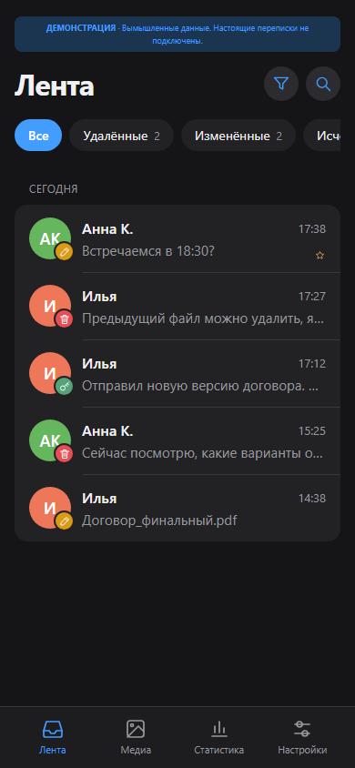
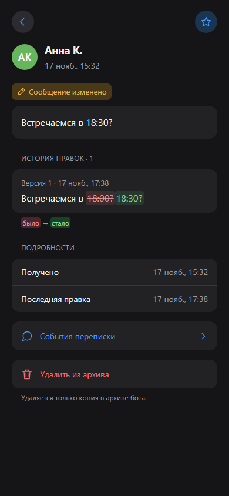

# ThreadDock

[](https://github.com/andreichernov201/ThreadDock/actions/workflows/pipeline.yml)
[](LICENSE)

Telegram-бот для скачивания медиа по ссылкам и личного архива Telegram Business.
Python 3.12+, aiogram 3, SQLite, yt-dlp, gallery-dl, FFmpeg и Deno. Веб-интерфейс архива —
Telegram Mini App без отдельной frontend-сборки.

## Возможности

- Видео: TikTok, Instagram Reels, YouTube/Shorts, VK Видео/Клипы, X/Twitter,
  Vimeo, Reddit и видеопубликации Pinterest.
- TikTok Photo Mode: слайдшоу, исходные фотографии и доступная аудиодорожка.
- Слайдшоу показывает каждую фотографию 3 секунды; длинная музыка обрезается,
  короткая повторяется. Для одного фото короткая музыка не удлиняется.
- При наличии Live Photo каждый кадр длится столько же, сколько самая длинная
  Live Photo, минимум 2 секунды. Музыка не сокращает движение.
- TikTok Live Photo с доступной видеочастью сохраняет движение в слайдшоу; «Фото» возвращает альбом
  с обычными фото и полными короткими видео живых кадров для совместимости клиентов.
- Фотографии и смешанные галереи Instagram, Reddit, Pinterest и X через gallery-dl.
- Доступные Stories TikTok/Instagram; тип исходного медиа сохраняется.
- Фото без музыки отправляются фотографиями, без немого MP4 и предупреждений.
- В группах администратор выбирает `/photos` или `/slideshow`; кнопки доступны всем.
- Несколько ссылок в сообщении, личные чаты, разрешённые группы и Business Connection.
- Очередь SQLite, кеш файлов и Telegram `file_id`, восстановление после перезапуска.
- Подготовка H.264/AAC MP4 и адаптация размера под отправку в Telegram.
- Архив Business-переписок: правки, удаления, поиск, вложения, избранное,
  уведомления, статистика, экспорт и PIN. Доступ ограничен владельцем.

Поддержка сайта зависит от доступности публикации, региона сервера и защиты
самого сайта. Закрытые и удалённые публикации могут быть недоступны.
Архив по умолчанию выключен; старую историю Telegram бот не загружает.

<p>
  
  
</p>

Снимки деморежима с вымышленными данными. Для просмотра интерфейса локально
открой `http://127.0.0.1:8080/?demo=1` при запущенном приложении.

## Запуск в Docker

Скопируй `.env.example` в `.env` и заполни `BOT_TOKEN` из
[@BotFather](https://t.me/BotFather). Если `.env` уже существует, сохрани свои настройки.

```sh
docker compose up -d --build
docker compose logs -f bot
```

База, кеш и архив находятся в постоянном томе `threaddock-data`. Контейнер
работает без root. Для остановки с сохранением данных:

```sh
docker compose down
```

Флаг `down -v` удаляет том с данными. Для публичного Mini App нужен HTTPS:
[VPS и домен](docs/vps.md), [GitHub Actions и деплой](docs/deployment.md).

## Локальный запуск

Нужны [uv](https://docs.astral.sh/uv/getting-started/installation/), Python 3.12+,
FFmpeg/ffprobe и Deno 2 в `PATH`. yt-dlp и gallery-dl устанавливаются из lock-файла:

```sh
uv sync --locked --extra media
uv run --extra media python main.py --check
uv run --extra media python main.py
```

Перед запуском заполни `.env`. Команды одинаковы в Windows, Linux и macOS.
`--check` проверяет конфигурацию и инструменты без подключения к Telegram;
`--check --no-token` не требует токена. Остановка — `Ctrl+C`.
Одну папку данных может использовать только один процесс.

Проверка скачивания без отправки в Telegram:

```sh
uv run --extra media python download.py "ССЫЛКА_НА_ПУБЛИКАЦИЮ"
```

Для параллельной работы с запущенным ботом задай отдельный `DATA_DIR`.
При активном webhook polling не запускается; бот не удаляет webhook автоматически.

## Разработка и проверки

Для Python-тестов и линтера не нужны токен, Docker или сервер:

```sh
uv sync --locked
uv run python scripts/check.py
```

Полная среда с медиатулзами и Chromium находится в `.devcontainer/` и подходит
для VS Code Dev Containers и GitHub Codespaces. Установка на своей машине,
полные проверки и порядок работы с PR: [CONTRIBUTING.md](CONTRIBUTING.md).
Карта проекта и команды для агентов: [AGENTS.md](AGENTS.md).

CI проверяет Python 3.12–3.15 на Linux и Python 3.14 на Windows/macOS, интерфейс
в Chromium, конфигурации Compose и production-образ. Живые проверки Telegram
и соцсетей выполняются отдельно: [список приёмки](docs/release-checklist.md).

## Использование

В личном чате отправь ссылку. Для Photo Mode под результатом доступны исходные
фотографии и аудио, если они есть. Повторные нажатия не создают новую загрузку.

| Назначение | Команды |
| --- | --- |
| Загрузчик | `/start`, `/help`, `/status` |
| Разрешение групп | `/enable`, `/disable` — администратору группы |
| Фотопубликации группы | `/photos`, `/slideshow` — администратору группы |
| Архив | `/archive`, `/archive_on`, `/stats`, `/export`, `/pause`, `/mute`, `/delete_me` |

В группах обработка по умолчанию выключена. Для обычных сообщений отключи
Privacy Mode у BotFather и добавь бота заново либо назначь администратором.
Ответ сохраняет исходную тему и привязку к сообщению.

Для Business включи Business Mode у BotFather и подключи бота в настройках
аккаунта Telegram. Выбери переписки и необходимые права. Ответы ограничены
правом `can_reply` и окном Telegram после входящего сообщения.
Подключение архива, хранение и ограничения: [docs/archive.md](docs/archive.md).

## Конфигурация

Все параметры и единицы измерения перечислены в [.env.example](.env.example).

| Параметр | По умолчанию | Назначение |
| --- | --- | --- |
| `DATA_DIR` | `data` | База, кеш, архив и логи |
| `DOWNLOAD_WORKERS` | `2` | Параллельные загрузки из разных переписок |
| `QUEUE_CAPACITY` | `200` | Вместимость активной очереди |
| `MAX_DOWNLOAD_MB` | `500` МиБ | Размер входного медиа |
| `MAX_UPLOAD_MB` | `49` МБ | Размер отправляемого файла |
| `CACHE_TTL_HOURS` | `72` | Срок кеширования (максимум 72 часа) |
| `ARCHIVE_STORAGE_MB` | `20480` МиБ | Общий бюджет локальных вложений архива |
| `ARCHIVE_PUBLIC_URL` | пусто | HTTPS-адрес Mini App |

Для авторизованных источников можно подключить Netscape cookie jar через
`COOKIES_FILE`. Docker-overlay: `compose.cookies.yaml`. Cookies, токен и база
не должны попадать в Git или Docker-образ. Версия yt-dlp закреплена в
`pyproject.toml` и `uv.lock`; Docker использует те же зависимости.

gallery-dl (GPL-2.0) запускается отдельной программой. Его код не копируется в
ThreadDock. Исходники и лицензия: https://github.com/mikf/gallery-dl.
Извлечение, скачивание и FFmpeg выполняются на сервере. Сторонние сервисы
скачивания и hosted resolver API не используются. TikTok разбирается через его
публичную страницу и собственный `/player/api/v1/items`. Подписанные playback
ссылки обрабатываются собственным сервером TikTok. Проверяются ID публикации,
HTTPS, домены и адреса назначения. H.264 получает приоритет для быстрой отправки.
Live Photo извлекается только когда сам TikTok возвращает её motion URL;
отсутствие URL не считается доказательством отсутствия движения. Для присланного
примера прямое получение motion пока не подтверждено. `TIKTOK_LIVE_PHOTOS=false`
отключает дополнительную проверку метаданных Live Photo.

Локальные yt-dlp и gallery-dl служат независимыми fallback. Их процессы ограничены
`EXTRACTOR_TIMEOUT_SECONDS` (по умолчанию 45 секунд); повторами управляет очередь.
Превышение лимита размера/длительности и ошибки конвертации не запускают заново
все загрузчики. Большие видео адаптируются под транспортный лимит Telegram одной
конвертацией; при низком битрейте уменьшается разрешение и частота кадров.
Сетевая приёмка: [docs/downloader-validation.md](docs/downloader-validation.md).
Instagram с IP сервера может требовать авторизованную сессию отдельного аккаунта.
Его пароль не нужен боту: подключается только локальный cookie jar.
[Подготовка отдельной сессии](docs/instagram-session.md).

## Данные и восстановление

Задачи сохраняются до скачивания и выполняются по порядку внутри переписки.
После перезапуска незавершённые загрузки возвращаются в очередь. Подтверждённые
Telegram-пачки повторно не отправляются. Если результат отправки неизвестен,
задача получает `uncertain`: сначала проверь чат, затем повтори вручную.

Для резервной копии останови экземпляр и используй `scripts/backup.py`.
Копия базы без файлов не заменяет полную копию архива.
Схема, сетевые ограничения и контракты: [docs/architecture.md](docs/architecture.md).
Сообщения об уязвимостях: [SECURITY.md](SECURITY.md). Лицензия: [MIT](LICENSE).
Изменения по версиям: [CHANGELOG.md](CHANGELOG.md).
