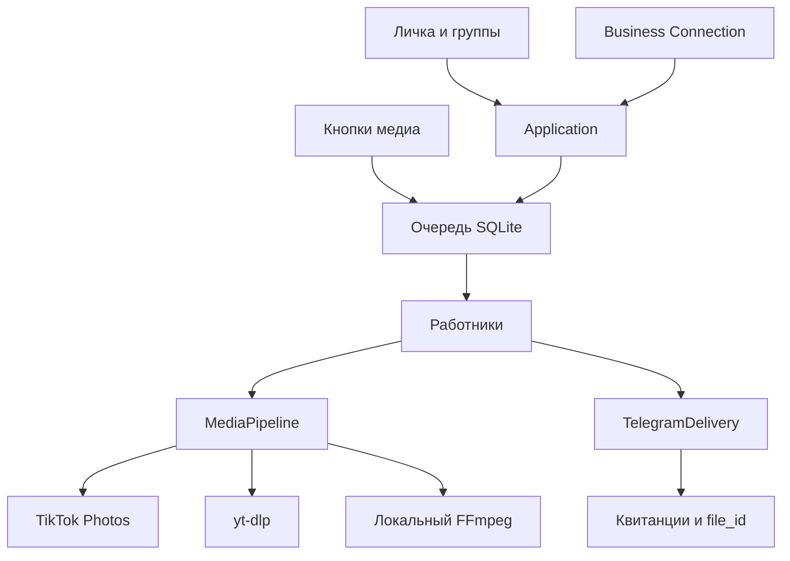

# Архитектура ThreadDock

## Поток запроса

| Модуль | Ответственность |
| --- | --- |
| `core/models.py` | Destination, Job, Asset, MediaBundle; без aiogram |
| `core/errors.py` | Безопасные публичные сообщения, коды ошибок и признак временного сбоя |
| `config.py` | Загрузка и валидация окружения |
| `handlers/` | Telegram-события, команды и авторизация кнопок |
| `services/application.py` | Контекст запроса, права источника, идемпотентная постановка ссылок |
| `services/jobs.py` | Работники, переходы статусов, повторы, остановка, обслуживание |
| `services/pipeline.py` | Кеш, рабочие каталоги, выбор адаптера и публикация результата |
| `services/ytdlp.py`, `services/tiktok.py` | Получение исходного медиа |
| `services/network.py`, `services/http.py` | Защищённый сетевой путь и ограниченные ответы |
| `services/media.py` | Локальные проверка, сборка и подготовка медиа |
| `services/delivery.py` | Bot API, reuse file_id, пачки и подтверждения доставки |
| `storage/database.py` | Небольшие атомарные SQLite-транзакции; WAL и версия схемы |
| `storage/lock.py` | Один процесс на каталог данных |

## Контракты

`MediaPipeline.fetch(url, render=RenderOptions())` возвращает `MediaBundle`: каталог результата,
необязательный MP4, исходные фотографии, упорядоченный смешанный набор `media`,
необязательное аудио и метаданные. При отсутствии музыки основной формат — фотографии.
TikTok сначала использует состояние публичной страницы, включая каноническое
написание `/video/` для Photo Mode; независимые fallback — yt-dlp и gallery-dl.
Галереи обрабатываются gallery-dl, файлы загружаются только через PublicHttp.
Временные
JSON/cookies/исходные видеодорожки удаляются до публикации кеша. Manifest содержит
только относительные пути. Файлы не загружаются в Telegram по удалённому URL.

`Destination` содержит маршрут доставки: chat/message/thread, инициатор и
Business Connection ID. Он не содержит текста сообщения. Один сервис работает
со всеми источниками, а разрешение и фильтр отправителя повторно проверяются перед доставкой.
Настройки кадра фиксируются в задаче при приёме ссылки. Отличающиеся параметры
имеют разные ключи кеша; стандартные сохраняют прежний ключ во всех типах чатов.
Персональные настройки берутся у владельца Business-подключения, а не у собеседника.

Личный фильтр отправителей удалён; Business принимает обе стороны. Групповые
фильтры проверяются как раньше. Для двух подключений одной переписки `business_events`
сопоставляет пару аккаунтов и отпечаток отправителя, времени Telegram, текста и
ссылок; текст хранится только как SHA-256. Разные локальные `message_id` связываются
в `business_event_routes`. Одинаковые сообщения одной секунды сохраняются отдельными
вхождениями: каждое подключение может присоединиться к вхождению только один раз.

Для каждой ссылки `business_requests` атомарно закрепляет первую готовую задачу.
Подготовка учитывает настройки каждого владельца, доставка блокируется на общую
переписку и сохраняет порядок ссылок. Явный отказ до первой принятой пачки освобождает
выбор для второго подключения. Подтверждённая пачка и `uncertain` закрепляют выбор
и отменяют дубли, в том числе после перезапуска. Ошибка подготовки не опережает
ещё работающий второй запрос, а общий отказ сообщается один раз. Служебные связи
очищаются вместе с завершёнными задачами; явные кнопки фото/аудио создают отдельные действия.

Короткие ссылки TikTok раскрываются через PublicHttp с браузерным TLS. При наличии
`share_comment_id` или `comment_id` выбирается только совпавший комментарий того же
видео из ответа TikTok. Запрос выполняется параллельно медиа, не дольше 5 секунд;
отсутствие текста не мешает отправке видео без подписи. Комментарий входит в ключ
запроса, поэтому подписи разных комментариев и обычной ссылки не смешиваются.
Исходный ключ сохраняется после раскрытия короткой ссылки: активная задача
защищает свою запись кеша от очистки. Подпись отправляется обычным текстом один
раз, на первом элементе; кнопка аудио не дублирует комментарий.

Явные адреса эфиров TikTok/Instagram отклоняются до скачивания. yt-dlp сообщает
структурированный live-статус до фильтрации; активные/будущие эфиры и `post_live`
не скачиваются и не передаются запасным загрузчикам. Готовый `was_live` допускается.

Работники подготовки атомарно резервируют доступные задачи, включая несколько
ссылок одной переписки. Результат сохраняется в кеш и переводится в `ready`.
Работники доставки резервируют только первую готовую задачу переписки, не
пропуская более ранние ожидающие/выполняющиеся задачи. Ошибки подготовки тоже
проходят через `ready`, поэтому сообщения не обгоняют предыдущие ссылки.
`phase` различает подготовку и доставку при восстановлении. Ожидание `ready`
не занимает работника и не расходует минуту; потраченные `active_elapsed` и
`active_since` учитывают подготовку, повторы и отправку. Heartbeat ограничивает
оценку работы после аварии, штатная остановка приостанавливает отсчёт. Для одной
папки используется один процесс приложения с несколькими async-работниками.
SQLite-операции короткие, синхронные и принадлежат одному event loop; внутри
транзакций нет await. Для многопроцессного режима нужен отдельный пересмотр
резервирования, блокировок файлов и лимитов — сейчас он намеренно запрещён.

## Схема и сроки хранения

- `jobs`: URL публикации, маршрут, режим, статус, число попыток и позиция отправки.
- `cache`: относительный manifest и сроки жизни/LRU; активные задачи защищают кеш.
- `telegram_files`: file_id с областью bot ID, типом файла и именем ассета.
- `deliveries`: порядковые квитанции принятых Telegram пачек и ID сообщений.
- `groups`, `connections`, `business_chats`: реальные настройки доступа и окно ответов.
- `download_preferences`, `sender_allowlist`: настройки владельца/группы и разрешённые отправители.
- `state`: bot ID и heartbeat.

Завершённые задачи и квитанции удаляются по `JOB_RETENTION_DAYS`; кеш имеет
отдельную TTL/политику диска, не более 72 часов от первого сохранения.
`cache.saved_at` не сдвигается при повторном обращении или принудительном обновлении
непросроченного результата. Поколения каталогов и leases защищают уже отправляемые
файлы от очистки и замены другой задачей. Это служебные данные загрузчика, не архив переписок.
Один каталог нельзя переносить на другой bot token без отдельной миграции:
file_id привязан к боту. Замена токена того же бота поддерживается.

## Архив

1. Пакет `archive/` отвечает за архив, свою модель сообщений и сроки хранения.
2. Его router или middleware подключается в composition root `main.py` рядом
   с существующими routers. Он получает исходные Telegram updates самостоятельно,
   не извлекает тела сообщений из очереди загрузок.
3. `archive/repository.py` создаёт таблицы `archive_*` и расширяет их при
   инициализации. Архив использует ту же SQLite-базу; таблицы загрузчика не
   переиспользуются как архив. Изменения схемы должны сохранять существующие данные.
4. При необходимости сохранить медиа из ссылки архив использует `MediaPipeline`.
   Собственные файлы архива нужно скопировать в его хранилище: кеш загрузчика
   удаляемый, ссылка на него не является постоянным архивным объектом.
5. Для связи с отправленными результатами можно читать `deliveries` с собственным
   checkpoint по `id`; архивный consumer должен успевать до срока очистки квитанций.
   Архивные уведомления, медиа, экспорт и ответы используют отдельный постоянный
   outbox `archive_tasks`; очередь загрузчика не используется как архив сообщений.
6. Права и обработка Business update проверяются также архивным модулем.
   Разрешение скачивать ссылки не означает разрешение архивировать переписку.

Существующие загрузчики и TelegramDelivery менять для регистрации архивного
router не нужно. Архив не должен блокировать Telegram ingestion или работников
скачивания долгой синхронной обработкой.

Реализация и границы доступа описаны в [archive.md](archive.md). API выводит owner_id
только из проверенных Telegram-данных, все SQL-запросы к содержимому ограничены
этим владельцем. Страница не получает токен бота или физические пути файлов.
Тексты Telegram/Python собраны в `core/texts.py`, интерфейса — в `archive/web/texts.js`.

## Границы гарантий

SQLite фиксирует задачи и принятые пачки, но Bot API не поддерживает exactly-once
отправку. Неопределённая отправка требует проверки человеком; известный отказ
по file_id допускает повтор с локальным файлом. Retry-after не считается успешной
отправкой. После сбоя во время downloading задача безопасно возвращается в очередь.
